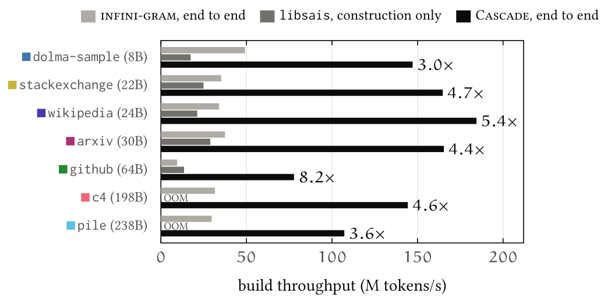
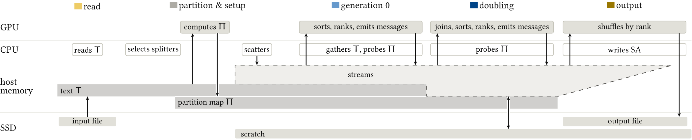
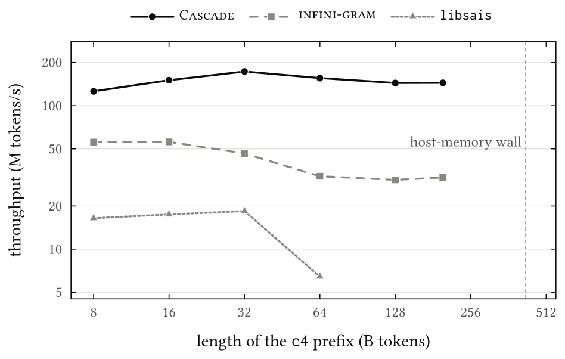
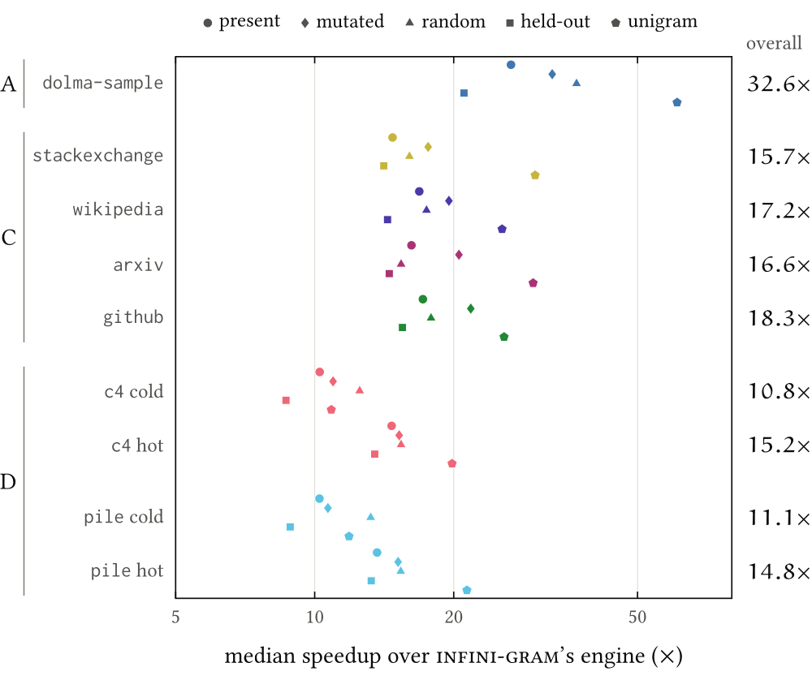

---
hide:
  - navigation
---

# Cascade

**GPU-accelerated out-of-core suffix array construction for LLM corpora.**

Jamshed Khan and Prashant Pandey, Northeastern University

[Paper (arXiv)](https://arxiv.org/abs/2610.15254){ .md-button .md-button--primary }
[Code (GitHub)](https://github.com/saltsystemslab/Cascade){ .md-button }
[Cite](#citation){ .md-button }

Suffix arrays power deduplication, contamination testing, n-gram statistics, and training-data attribution over the corpora used to train large language models, and every new corpus or tokenizer needs a new one.
Cascade builds the suffix array of a tokenized corpus on a single GPU server, for corpora many times larger than the GPU's memory, and searches it with a batched query engine.

While LLM corpora motivate its design, nothing in it depends on them.
Cascade can index any sequence of symbols, such as genome collections or plain bytes.

<figure markdown="span">
  { width="720" }
  <figcaption>Build throughput on seven corpora of 8–238 billion tokens. Labels give Cascade's end-to-end speedup over infini-gram's indexing pipeline; libsais is timed on its construction alone, its most favorable measure.</figcaption>
</figure>

## Why Cascade?

- **Fast.** Cascade builds the suffix array 3.0–8.2× faster end to end than [infini-gram](https://infini-gram.io/)'s indexing pipeline on seven corpora of 8–238 billion tokens, and its construction is 6.3–11.4× faster than [libsais](https://github.com/IlyaGrebnov/libsais)'s.
- **Not bound by GPU memory.** Cascade sorts its partitions on the GPU independently and never merges them.
  Thus GPU memory limits only the partition size and not the corpus size.
  With just 5 GB of GPU memory (a sixteenth of the peak usage), suffix array builds over the arxiv (30B) and the github (64B) corpora take only 1.3× and 1.5× as long as the builds that use the full GPU memory.
- **Light on host memory.** Cascade streams the ranks of suffixes between partitions as messages, instead of storing them in a corpus-wide rank table (the inverse suffix array, ISA).
  Its intermediate data gracefully spills across GPU memory, host memory, and SSD.
  Host memory only needs to hold the text: on our server with 1 TB of host DRAM, Cascade indexes the 198B-token c4 and the 238B-token pile corpora in 23 and 37 minutes, where libsais runs out of memory.
- **Exact.** Cascade never truncates suffix comparisons, and thus the suffix arrays are exact.
- **Fast queries.** Cascade's batched query engine reproduces infini-gram's counts at median speedups of 10.8–32.6×, with the index in GPU memory, host memory, or on SSD.

## How it works

Cascade samples K-grams of the text to choose splitters that give each partition a fixed, contiguous range of the final suffix array.
The GPU then sorts each partition, iteratively in generations, by prefix doubling.
Between generations, every rank is sent directly to the one partition that needs it, as a message.
An invariant keeps every rank comparison within the same partition, so partition-local ranks suffice.
These messages and the suffixes' records are elastic: they fill the room left in host memory and spill to SSD beyond it.
Each finished partition is written directly to its range of the output.
The [paper](https://arxiv.org/abs/2610.15254) has the details and the proofs.

<figure markdown="span">
  
  <figcaption>A build end to end: where each of its five phases runs, and where its data lives. The text and the partition map are held in host memory until the ends of generation 0 and of the doubling; the streams of records and messages take the rest of the host-memory budget and spill to SSD beyond it.</figcaption>
</figure>

## Results

All runs use one server: an NVIDIA RTX PRO 6000 Blackwell GPU with 96 GB of memory, two 64-core Intel Xeon 6710E CPUs, 1 TB of host memory, and two 3.84 TB NVMe SSDs.
The corpora are arrays of 16-bit token IDs, the layout infini-gram indexes.

### Build time

Build times in minutes: end to end against infini-gram's pipeline, from reading the token array until the index is durably written, and of the construction alone against libsais.

| Corpus | infini-gram, end to end | Cascade, end to end | × | libsais, construction | Cascade, construction | × |
|---|---:|---:|---:|---:|---:|---:|
| dolma-sample (8B) | 3 | 1 | 3.0 | 8 | 1 | 10.5 |
| stackexchange (22B) | 10 | 2 | 4.7 | 15 | 2 | 8.4 |
| wikipedia (24B) | 12 | 2 | 5.4 | 19 | 2 | 11.4 |
| arxiv (30B) | 13 | 3 | 4.4 | 17 | 2 | 7.3 |
| github (64B) | 113 | 14 | 8.2 | 79 | 12 | 6.3 |
| c4 (198B) | 104 | 23 | 4.6 | OOM | 19 | – |
| pile (238B) | 134 | 37 | 3.6 | OOM | 31 | – |

The corpus sizes are in tokens; the speedups (×) are computed from the times in seconds, and OOM marks libsais running out of host memory.

### Scaling

<figure markdown="span">
  { width="600" }
  <figcaption>End-to-end throughput on prefixes of c4, up to the whole corpus (198B tokens). Cascade keeps its rate as the corpus grows, while libsais runs out of host memory from 128B tokens on. The dashed line marks where the host-memory budget fills: the wall for Cascade and infini-gram on our server.</figcaption>
</figure>

### Queries

<figure markdown="span">
  { width="600" }
  <figcaption>Median speedup of Cascade's batched query engine over infini-gram's, per workload type, with matching counts on every batch. The engine places each index where it fits: A, in GPU memory; C, in host memory; D, with the suffix array on SSD, from a cold or a hot page cache. At the right, the median over all 18 workloads.</figcaption>
</figure>

## Getting started

The [README](https://github.com/saltsystemslab/Cascade#readme) covers the requirements, [building](https://github.com/saltsystemslab/Cascade#building), [preparing the input](https://github.com/saltsystemslab/Cascade#preparing-the-input), [building a suffix array](https://github.com/saltsystemslab/Cascade#building-a-suffix-array), and [querying](https://github.com/saltsystemslab/Cascade#querying).
Documentation pages will follow with the packaged release.

## Citation

Jamshed Khan and Prashant Pandey.
*Cascade: GPU-Accelerated Out-of-Core Suffix Array Construction for LLM Corpora.*
arXiv:2610.15254, 2026.

```bibtex
@misc{khan2026cascade,
  title         = {Cascade: {GPU}-Accelerated Out-of-Core Suffix Array Construction for {LLM} Corpora},
  author        = {Khan, Jamshed and Pandey, Prashant},
  year          = {2026},
  eprint        = {2610.15254},
  archivePrefix = {arXiv},
  primaryClass  = {cs.DS},
  doi           = {10.48550/arXiv.2610.15254},
}
```

## License

Cascade is licensed under the [Apache License 2.0](https://github.com/saltsystemslab/Cascade/blob/main/LICENSE).
